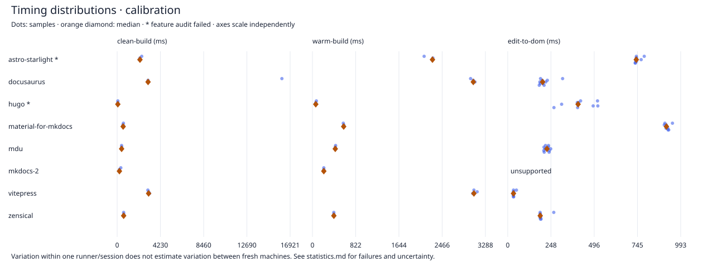

# Within-run statistics

Run: 40139448552-1

MAD is the median absolute deviation. All valid samples are retained; failed and unsupported observations are counted separately.

95% percentile-bootstrap intervals for the median use 5,000 resamples with a fixed seed, only for builds with n ≥ 10. They assume independent observations and describe this run only. Shared host caches can violate this assumption. Edits share one server/browser session, so no confidence interval is reported for them. p95 uses linear interpolation and is shown only for n ≥ 30. Neither threshold makes a ranking reliable; repeat on fresh runners and resolve feature differences first.

| Participant | Scenario | Feature audit | n | Failed | Unsupported | Median ms | MAD ms | Min–max ms | p95 ms | Median CI95 ms |
| --- | --- | --- | ---: | ---: | ---: | ---: | ---: | --- | ---: | --- |
| astro-starlight | clean-build | fail | 3 | 0 | 0 | 2230.3 | 71.7 | 2158.6–2401.4 | — | — |
| astro-starlight | edit-to-dom | fail | 10 | 0 | 0 | 737.9 | 2.5 | 731.4–783.6 | — | — |
| astro-starlight | warm-build | fail | 3 | 0 | 0 | 2281.5 | 8.6 | 2123.4–2290.1 | — | — |
| docusaurus | clean-build | pass | 3 | 0 | 0 | 3022.0 | 41.8 | 2980.2–16114.9 | — | — |
| docusaurus | edit-to-dom | pass | 10 | 0 | 0 | 200.1 | 14.6 | 180.9–315.0 | — | — |
| docusaurus | warm-build | pass | 3 | 0 | 0 | 3058.1 | 31.9 | 3006.7–3090.1 | — | — |
| hugo | clean-build | fail | 3 | 0 | 0 | 64.0 | 2.4 | 61.5–67.8 | — | — |
| hugo | edit-to-dom | fail | 10 | 0 | 0 | 403.8 | 50.5 | 265.3–517.1 | — | — |
| hugo | warm-build | fail | 3 | 0 | 0 | 63.0 | 2.7 | 60.3–74.6 | — | — |
| material-for-mkdocs | clean-build | pass | 3 | 0 | 0 | 585.0 | 20.4 | 564.5–611.3 | — | — |
| material-for-mkdocs | edit-to-dom | pass | 10 | 0 | 0 | 910.9 | 8.1 | 898.6–945.4 | — | — |
| material-for-mkdocs | warm-build | pass | 3 | 0 | 0 | 593.7 | 0.8 | 586.5–594.6 | — | — |
| mdu | clean-build | pass | 3 | 0 | 0 | 433.8 | 5.2 | 417.5–439.1 | — | — |
| mdu | edit-to-dom | pass | 10 | 0 | 0 | 225.2 | 12.9 | 207.2–246.8 | — | — |
| mdu | warm-build | pass | 3 | 0 | 0 | 433.7 | 0.4 | 433.3–440.5 | — | — |
| mkdocs-2 | clean-build | pass | 3 | 0 | 0 | 220.7 | 9.0 | 211.7–357.5 | — | — |
| mkdocs-2 | edit-to-dom | pass | 0 | 0 | 1 | — | — | —–— | — | — |
| mkdocs-2 | warm-build | pass | 3 | 0 | 0 | 215.8 | 0.4 | 215.3–216.2 | — | — |
| vitepress | clean-build | pass | 3 | 0 | 0 | 3075.2 | 70.7 | 3004.5–3169.3 | — | — |
| vitepress | edit-to-dom | pass | 10 | 0 | 0 | 33.0 | 0.4 | 32.6–49.9 | — | — |
| vitepress | warm-build | pass | 3 | 0 | 0 | 3069.9 | 22.3 | 3047.5–3131.7 | — | — |
| zensical | clean-build | pass | 3 | 0 | 0 | 633.6 | 3.0 | 630.5–643.6 | — | — |
| zensical | edit-to-dom | pass | 10 | 0 | 0 | 186.5 | 1.2 | 185.2–264.3 | — | — |
| zensical | warm-build | pass | 3 | 0 | 0 | 406.8 | 0.6 | 406.2–410.8 | — | — |

