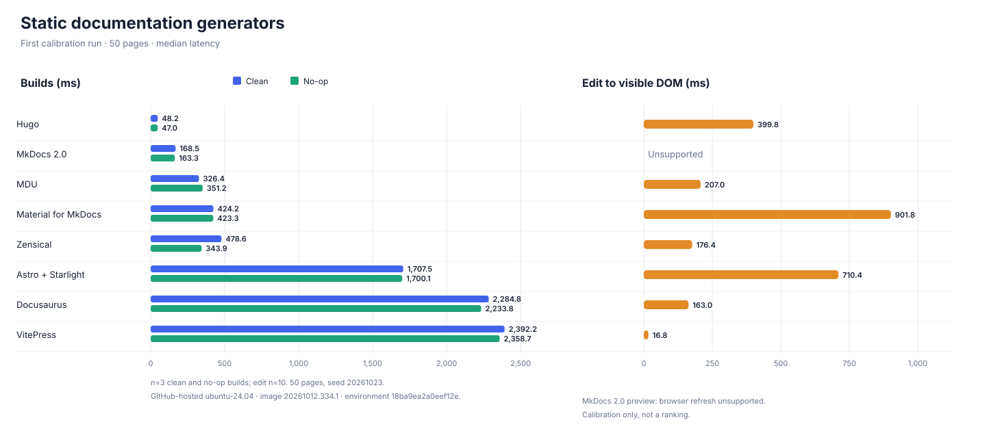

# First calibration run

Run: 40016228825-1 · 2026-10-23T20:04:41.085Z · 50 pages · 3 build samples · 10 edits

These are calibration results, not a ranking. Values are medians in milliseconds; the count is successful observations.

| Generator | Clean build (ms) | No-op build (ms) | Edit to visible DOM (ms) |
| --- | ---: | ---: | ---: |
| zensical | 478.6 (3) | 343.9 (3) | 176.4 (10) |
| mdu | 326.4 (3) | 351.2 (3) | 207.0 (10) |
| docusaurus | 2284.8 (3) | 2233.8 (3) | 163.0 (10) |
| vitepress | 2392.2 (3) | 2358.7 (3) | 16.8 (10) |
| material-for-mkdocs | 424.2 (3) | 423.3 (3) | 901.8 (10) |
| astro-starlight | 1707.5 (3) | 1700.1 (3) | 710.4 (10) |
| hugo | 48.2 (3) | 47.0 (3) | 399.8 (10) |
| mkdocs-2 | 168.5 (3) | 163.3 (3) | unsupported |

Workflow: [GitHub Actions run 40016228825](https://github.com/capjan/ssg-benchmarks/actions/runs/40016228825)

Environment profile: `18ba9ea2a0eef12e` · `ubuntu24` image `20261012.334.1` · AMD EPYC 9V45 96-Core Processor · 4 logical CPUs.

