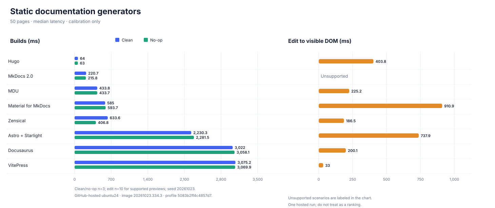

# Preliminary smoke benchmark

Run: 40139448552-1 · 2026-10-24T22:41:52.165Z · 50 pages · 3 build samples · 10 edits

These are calibration results, not a ranking. Values are medians in milliseconds; the count is successful observations.

| Generator | Clean build (ms) | No-op build (ms) | Edit to visible DOM (ms) |
| --- | ---: | ---: | ---: |
| Material for MkDocs | 585.0 (3) | 593.7 (3) | 910.9 (10) |
| Hugo | 64.0 (3) | 63.0 (3) | 403.8 (10) |
| Astro + Starlight | 2230.3 (3) | 2281.5 (3) | 737.9 (10) |
| Zensical | 633.6 (3) | 406.8 (3) | 186.5 (10) |
| MkDocs 2.0 | 220.7 (3) | 215.8 (3) | unsupported |
| VitePress | 3075.2 (3) | 3069.9 (3) | 33.0 (10) |
| MDU | 433.8 (3) | 433.7 (3) | 225.2 (10) |
| Docusaurus | 3022.0 (3) | 3058.1 (3) | 200.1 (10) |

## Markdown feature parity

Pass means the generated output contains the expected semantic HTML and all fixture links/images resolve locally. Feature audit failures are reported separately and do not remove otherwise valid timing observations. The detailed evidence is in `feature-matrix.json`.

| Generator | Nested pages | Headings and paragraphs | Emphasis and inline code | Lists and block quotes | Tables and fenced code | Relative Markdown links | Local images |
| --- | --- | --- | --- | --- | --- | --- | --- |
| Material for MkDocs | Pass | Pass | Pass | Pass | Pass | Pass | Pass |
| Hugo | Pass | Pass | Pass | Pass | Pass | Fail | Fail |
| Astro + Starlight | Pass | Pass | Pass | Pass | Pass | Fail | Pass |
| Zensical | Pass | Pass | Pass | Pass | Pass | Pass | Pass |
| MkDocs 2.0 | Pass | Pass | Pass | Pass | Pass | Pass | Pass |
| VitePress | Pass | Pass | Pass | Pass | Pass | Pass | Pass |
| MDU | Pass | Pass | Pass | Pass | Pass | Pass | Pass |
| Docusaurus | Pass | Pass | Pass | Pass | Pass | Pass | Pass |

Workflow: [GitHub Actions run 40139448552-1](https://github.com/capjan/ssg-benchmarks/actions/runs/40139448552)

Environment profile: `5083b2ff4c4857d7` · `ubuntu24` image `20261023.334.3` · AMD EPYC 9V74 80-Core Processor · 4 logical CPUs.

